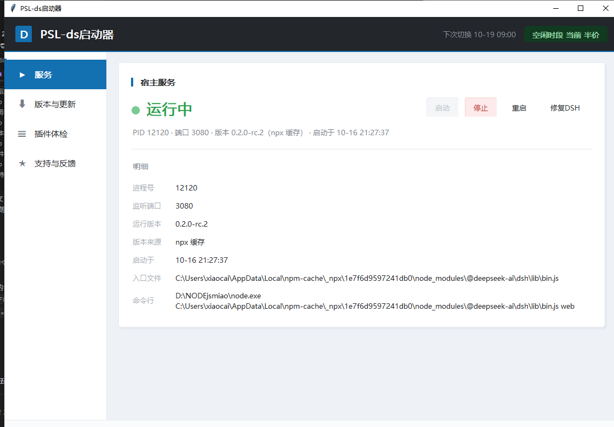
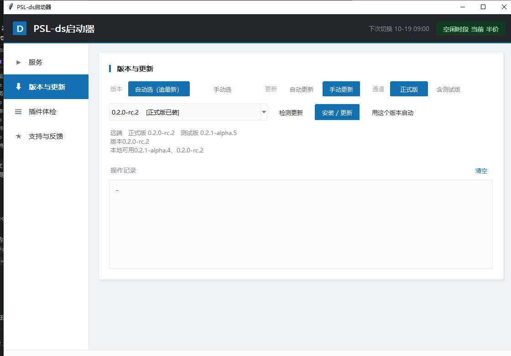
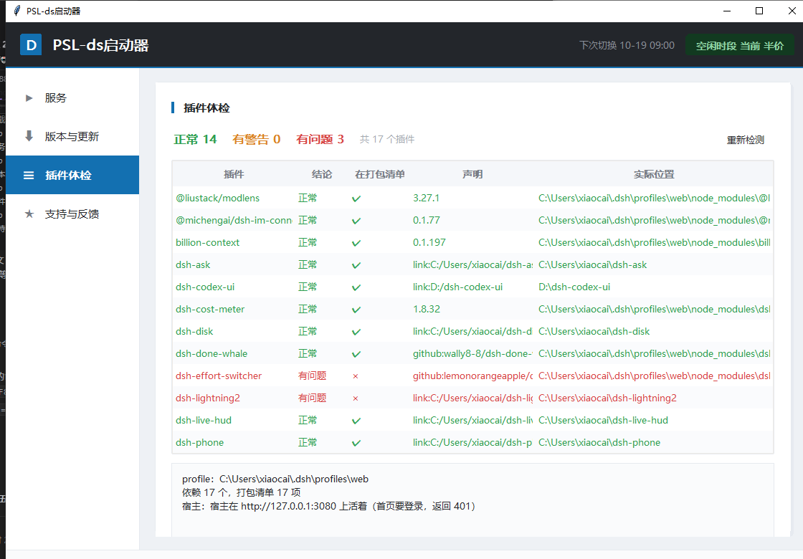
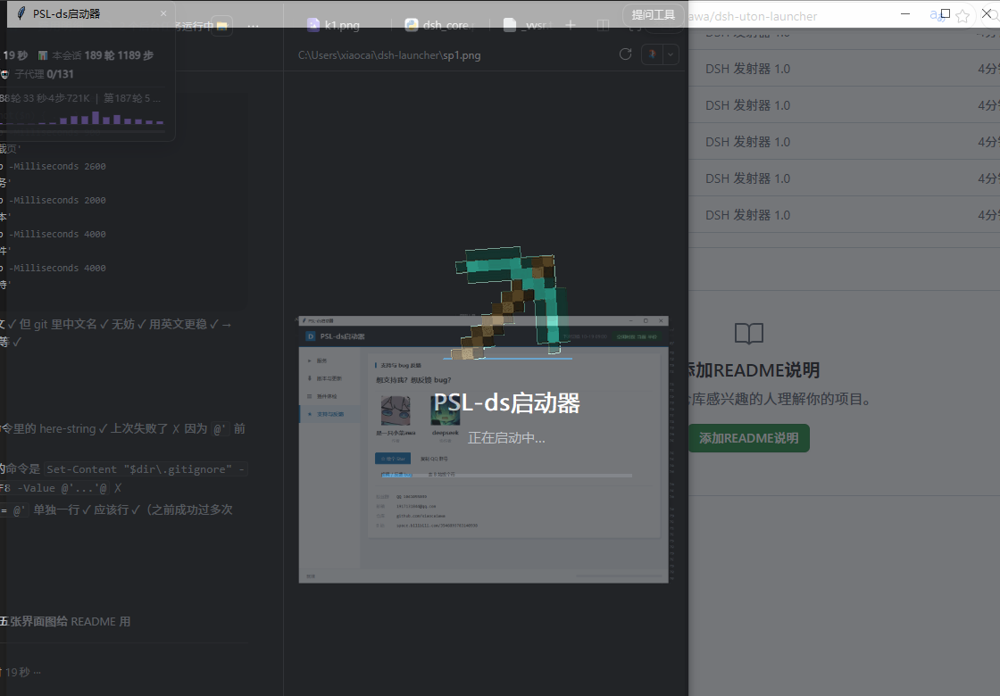

# DSH 启动器

DeepSeek Harness（DSH）的可视化启动器 —— 一个 exe，管住版本、插件和本地服务。



## 四个页面

| 页面 | 干什么 |
|---|---|
| **服务** | 启动 / 停止 / 重启本地 DSH 宿主，一键修复环境问题 |
| **版本与更新** | 自动或手动挑 DSH 版本、检测更新、装新版本、用指定版本启动 |
| **插件体检** | 四层判据检查所有插件的健康状态 |
| **支持与反馈** | 作者信息、Star、QQ 群、bug 反馈 |



## 功能细节

### 服务

- 显示 PID、监听端口、运行版本、版本来源（npx 缓存 / 本地安装）、启动时间、入口文件、完整命令行
- **启动 / 停止 / 重启** 一键完成
- **修复 DSH**：六项体检并自动处理 —— 环境变量污染、`%TEMP%\_MEI*` 残留、重复占用 3080 的进程、node / npm / 配置目录、插件声明、配置文件损坏
- 顶部常驻**峰谷提示**：现在算高峰（全价）还是空闲（半价），以及下次切换时间

### 版本与更新

- **自动选（追最新）** 或 **手动选** 版本
- **自动更新 / 手动更新** 两种模式（默认手动，不擅自下载）
- 通道可选 **正式版** 或 **含测试版**
- 版本列表标注「正式 / 测试」「已装 / 未装」；源用 npmmirror 镜像，国内直连
- 下载进度和日志实时显示；CMD 被关掉时可以一键中止等待

### 插件体检

四层判据，逐层排查，报错能指到具体哪一层：

1. **依赖声明** —— 在 profile 的 `package.json` 里吗
2. **打包清单** —— 在 `dsh.profile.bundles` 里吗
3. **文件到位** —— 本地文件真的在吗（`link:` 解析真实路径，junction 也认）
4. **跑起来了** —— 宿主在监听吗、`/<插件>/client.js` 拿得到吗

宿主没启动时不会误报全红，只在第 4 层记一条「没测」。



### 加载动画

启动时是一段「镐子敲一条蓝线」的像素动画。

位置、大小、蓝线高度都能自己调：跑 `mine_editor.py`（或打包好的**镐子调整器.exe**），拖滑块实时预览，参数存到 `~/dsh-launcher/mine.json`，**改完立刻生效，不用重新打包**。



## 环境要求

- Windows 10 / 11
- Python 3.10+（**只有从源码跑才需要**，且必须带 tkinter）
- 不需要 Node.js 就能启动 —— 但**下载 DSH 版本时需要**，启动器会自动检测

## 怎么用

**直接用（推荐）**：双击 `DSH启动器.exe`。单文件，不写注册表，删掉就干净。

**从源码跑**：

```bash
python dsh_launcher.py
python dsh_launcher.py --selftest   # 不开窗，只自检环境（排错用）
pip install pillow                  # 只有要重新生成镐子素材才需要
```

**自己打包**：

```bash
py -m PyInstaller --onefile --noconsole --clean --name DSHLauncher ^
  --hidden-import tkinter --hidden-import tkinter.font --hidden-import tkinter.ttk ^
  --add-data "assets;assets" dsh_launcher.py
```

> 打包前先清掉 `TCL_LIBRARY` / `TK_LIBRARY` / `_PYI_*` 环境变量，否则会打出缺 tkinter 的坏包。
> **产物小于 10 MB 基本就是坏包**，正常在 11.6 MB 左右。

## 文件说明

| 文件 | 作用 |
|---|---|
| `dsh_launcher.py` | 界面（tkinter，自绘控件 + 动画） |
| `dsh_core.py` | 不含界面的逻辑：版本、进程、峰谷、插件扫描、修复 |
| `mine_editor.py` | 镐子动画参数调整器 |
| `mine.json` | 镐子动画参数（可以手改） |
| `assets/` | 镐子 14 帧旋转素材 + 作者 / 协作者头像 |
| `说明.txt` | 给使用者看的简版说明 |

## 支持

- ⭐ 给个 Star
- 粉丝群：QQ **1061055039**
- 邮箱：**1917131844@qq.com**
- B 站：<https://space.bilibili.com/3546893783140938>

## 许可

MIT
